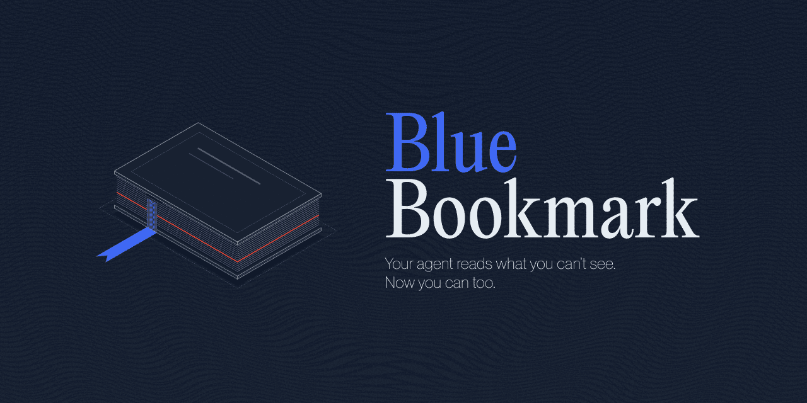

<p align="center">
  
</p>

<p align="center">
  <a href="LICENSE"></a>
  
  
  <a href="https://n8n.io/"></a>
  <a href="docs/EVAL.md"></a>
</p>

# Blue Bookmark

[How it works](#how-it-works) · [Results](#results) · [Get started](#get-started)

**What it is.** An n8n node that checks every email for hidden prompt injection before your AI agent reads it. No LLM call, runs offline, free.

**What it does.** It reads the email the way the agent does, including what a person never sees, and gives it a score from 0 to 100:

- **0–29:** clean, pass it on.
- **30–69:** suspicious, a person should look.
- **70–100:** an attack, quarantine it.

**Why it helps.**

- It sees what you can't: white text, `display:none`, invisible characters, encoded instructions.
- It can't be talked out of a finding. An LLM guard can be argued with or go silent; this gives the same score every time.
- Every finding shows where it is and why, so a person can check it in seconds.

## How it works

| If the email… | It is caught by |
|---|---|
| Hides text with HTML or CSS | hidden HTML check |
| Hides text in invisible or reversed characters | invisible character checks |
| Swaps letters for lookalikes | lookalike check |
| Encodes the instruction (base64, hex, split pieces) | decoding |
| Talks to the agent ("ignore previous instructions") | instruction check |
| Fakes a chat (`<\|assistant\|>`, `[END USER]`) | fake structure checks |
| Splits the attack over subject, body and attachments | cross-part check |

It does **not** judge what plain text means. That is the job of the LLM guard after it.

## Results

| | Prototype | v1 |
|---|---|---|
| Hardest attacks blocked (beat every Microsoft defence) | 41% | **81%** |
| Normal emails blocked by mistake | 0 / 73 | **0 / 73** |

Measured once on LLMail-Inject attacks set aside before v1 was tuned.

- [Evaluation](docs/EVAL.md): every set and every number.
- [Limitations](docs/LIMITATIONS.md): what these results do not cover yet.

## Get started

<p align="center">
  <a href="docs/SETUP.md"></a>
</p>

1. Build the node: `npm install && npm run build`.
2. Copy it into `~/.n8n/custom/BlueBookmark` and restart n8n.
3. Import [`examples/n8n/email-guard.json`](examples/n8n/email-guard.json) and run it.

### Set up with an AI agent

Claude Code, Codex, Cursor and similar agents can do the setup for you. They read [AGENTS.md](AGENTS.md). Paste this prompt into your agent:

```text
Clone https://github.com/aleks-gotsa/blue-bookmark and follow AGENTS.md to install the Blue Bookmark node in my n8n. Ask me for anything you need.
```

You still restart n8n and wire the node to your own mail trigger.

Also usable as a TypeScript library and in the browser: see the [setup guide](docs/SETUP.md#other-ways-to-use-it). Found a bypass? [SECURITY.md](SECURITY.md).

---

Built by [Aleks Gotsa](https://github.com/aleks-gotsa) · Last updated October 2026 · [MIT License](LICENSE)
